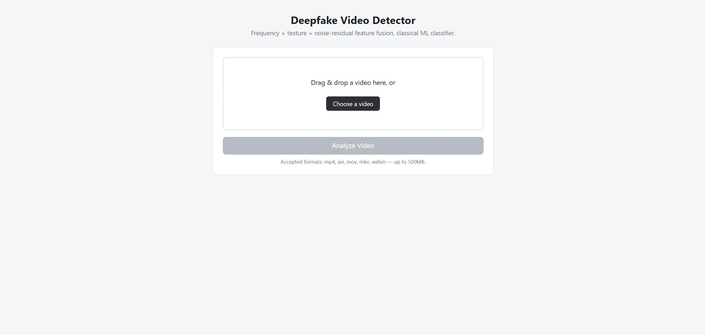
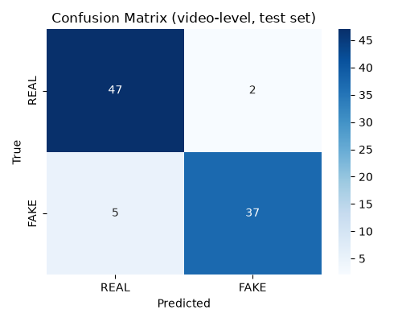
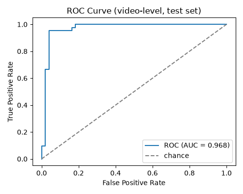
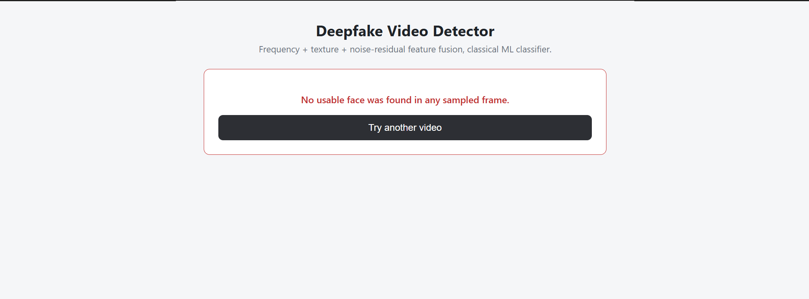
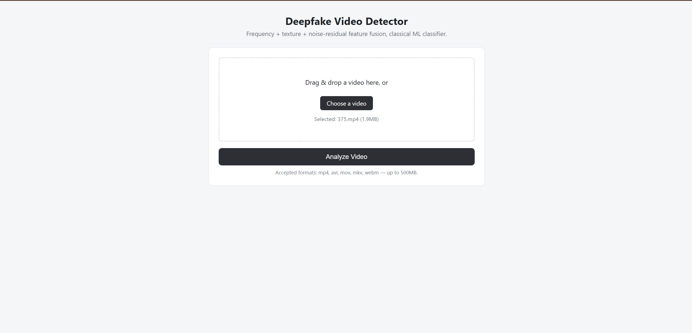
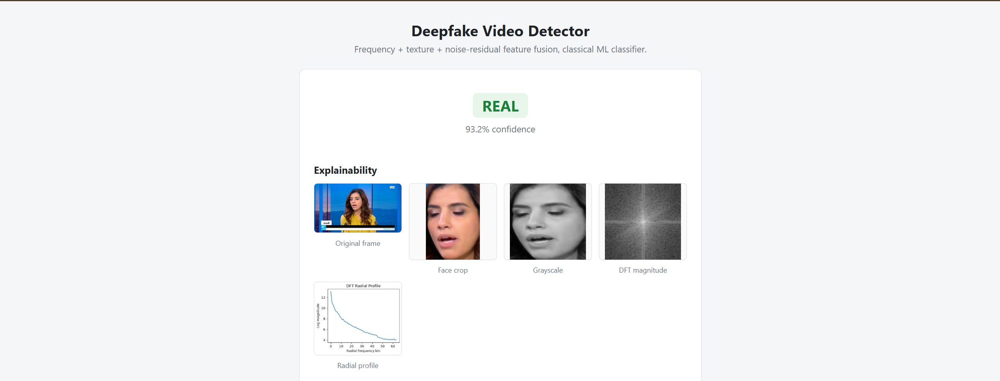
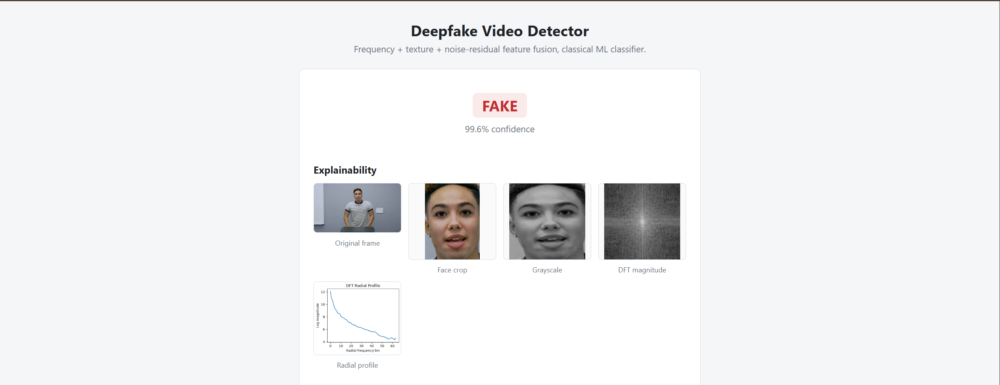
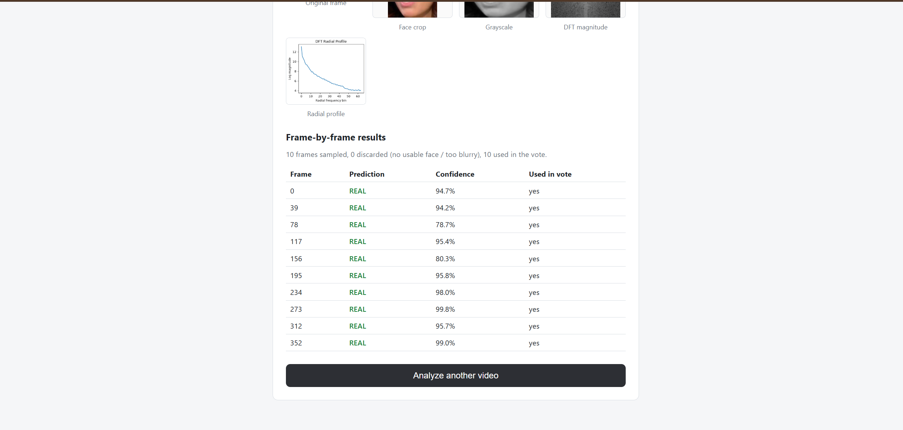
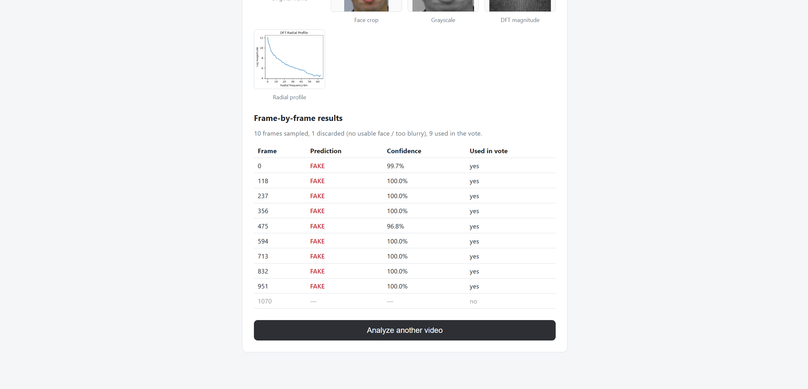

# Deepfake Video Detector

A deepfake video detector that fuses **frequency-domain**, **texture**, and
**noise-residual** handcrafted features and classifies them with a tuned
classical ML model (SVM) — no deep CNN required. Built with a Flask backend
and a vanilla HTML/CSS/JS frontend.



## Results

| Metric | Value |
|---|---|
| **Test accuracy (video-level)** | **92.3%** (91/92 videos scored) |
| ROC-AUC | 0.968 |
| Precision (REAL / FAKE) | 90.4% / 94.9% |
| Recall (REAL / FAKE) | 95.9% / 88.1% |
| F1 (REAL / FAKE) | 93.1% / 91.4% |
| Cross-validation F1 (train, 5-fold) | 0.9541 ± 0.0121 |

These are **video-level** metrics: each video is scored by sampling 10 frames,
running the classifier on every frame with a usable face, and combining the
per-frame probabilities via confidence-weighted voting into one verdict.

Full write-up, including a candid discussion of what could still be wrong with
this number: [`documentation/evaluation_report.md`](documentation/evaluation_report.md).
Per-video error analysis: [`documentation/error_analysis.md`](documentation/error_analysis.md).

<p float="left">
  
  
</p>

## How it works

```
Video → sample frames → MTCNN face detection → quality filter (confidence + blur)
      → face crop → resize 128×128 → grayscale
      → ┌─ DFT → radial frequency profile (64-d)
        ├─ Local Binary Pattern histogram (18-d)
        └─ noise residual (image − Gaussian-blurred image) → 5 summary stats
      → concatenate (87-d feature vector)
      → StandardScaler → SMOTE → PCA (95% variance) → SVM
      → per-frame P(fake) → confidence-weighted vote across frames
      → REAL / FAKE + confidence
```

**Frequency branch** — GAN-generated faces leave a different spectral
signature than camera-captured ones; the DFT magnitude spectrum, radially
averaged, captures this as a compact 1D fingerprint.

**Texture branch** — uniform LBP captures micro-texture differences around
blending boundaries that face-swap artifacts tend to introduce.

**Noise-residual branch** — real camera sensors leave a consistent noise
floor (PRNU-like); GAN output typically doesn't match it. Approximated here
as `original − Gaussian-blurred(original)`, summarized by mean/std/skew/
kurtosis/energy.

## Dataset

[FaceForensics++](https://github.com/ondyari/FaceForensics) (C23 compression),
face-swap deepfakes — **500 videos total** (250 real, 250 fake). Not included
in this repo (requires its own license and is ~2GB); see
[Setup](#setup) for how it's expected to be laid out locally.

### Split methodology

Video-level splitting alone isn't enough for this dataset: the same actor's
face appears across multiple *different* video files under different
filenames. An early version of this project split by filename only and scored
a suspicious **99% test accuracy** — investigation found the same actors
appearing in both train and test under different clips. The fix (documented
in detail in the module docstrings of `data_split.py` and
`identity_grouping.py`):

- **Fake videos** are grouped by *source actor* (parsed from the
  `{source}_{target}__scenario__hash.mp4` filename — the source actor's face
  is what's actually swapped into frame).
- **Real videos** have no identity in the filename, so they're grouped by
  face-embedding clustering (facenet-pytorch `InceptionResnetV1`, cosine
  similarity > 0.5).
- Groups are assigned to splits via a deterministic greedy rule (largest
  group first, filling whichever split has the biggest remaining quota).
- A known, documented limitation: cross-matching fake source actors against
  real-video identities was attempted (to catch a person appearing as *both*
  a real video and a deepfake source) but came back inconclusive — GAN
  face-swap alters the embedding too much for reliable matching with this
  approach.

| Split | Real | Fake | Total |
|---|---|---|---|
| Train | 160 | 165 | 325 |
| Validation | 40 | 43 | 83 |
| Test | 50 | 42 | 92 |
| **Total** | **250** | **250** | **500** |

Frame-level samples after MTCNN face detection + quality filtering (5
frames/video sampled for train/val): **1,445 train**, **370 validation**
frame-level examples.

## Model selection

Compared via `GridSearchCV` + 5-fold **group-aware** cross-validation
(`StratifiedGroupKFold`, grouped by source video — no video's frames split
across a fold boundary) on the training set only:

| Model | CV F1 (mean ± std) | Best params |
|---|---|---|
| Random Forest | 0.9382 ± 0.0096 | `max_depth=None, min_samples_leaf=1, n_estimators=300` |
| Gradient Boosting | 0.9386 ± 0.0154 | `learning_rate=0.1, max_depth=4, n_estimators=200` |
| **SVM (selected)** | **0.9541 ± 0.0121** | `C=10, gamma=0.01` (RBF kernel) |
| MLP (baseline only, not eligible) | 0.9081 val accuracy | — |

Pipeline: `StandardScaler → SMOTE → PCA(0.95 variance) → SVM`, built as an
`imblearn` pipeline so `GridSearchCV` refits the whole thing per fold — SMOTE
only ever resamples that fold's own training portion. The winning
configuration was confirmed on a held-out validation set (92.6% accuracy),
then retrained on train+validation combined for the final model.

## Project structure

```
config.py                    # all paths/thresholds/hyperparameters, one place
feature_extraction.py        # DFT + LBP + noise-residual feature fusion
face_utils.py                 # MTCNN face detection + quality filtering
identity_grouping.py         # source-actor / face-embedding identity grouping
data_split.py                 # identity-aware train/val/test split -> splits.json
train.py                      # GridSearchCV model selection + training
inference.py                  # video-level prediction (confidence-weighted voting)
evaluate.py                   # test-set metrics, confusion matrix, error analysis
explainability.py             # per-request visualization images for the API
app.py                        # Flask app: "/" frontend + "/analyze" API

templates/, static/           # frontend (vanilla HTML/CSS/JS)
tests/                        # unit tests + a small sample video
documentation/                # evaluation report, confusion matrix, ROC curve
snapshots/                    # UI screenshots (see below)
```

## Setup

Requires Python 3.13 (CPU-only; no GPU assumed anywhere in the pipeline).

```bash
py -3.13 -m venv venv
.\venv\Scripts\Activate.ps1
python -m pip install torch torchvision --index-url https://download.pytorch.org/whl/cpu
python -m pip install -r requirements.txt
```

Place the FaceForensics++ dataset at:
```
dataset/training/real/       (200 videos)
dataset/training/deepfake/   (200 videos)
dataset/testing/real/        (50 videos)
dataset/testing/deepfake/    (50 videos)
```
(These folder names are just the original download layout — `data_split.py`
pools and re-splits all 500 videos by identity group; `splits.json` is the
actual source of truth for which split a video belongs to.)

```bash
python data_split.py    # builds splits.json (~5-8 min, face-embedding clustering)
python train.py         # trains + selects the model (~30-40 min, MTCNN extraction)
python evaluate.py      # scores the test set, writes documentation/
pytest tests/           # unit tests for feature extraction
python app.py           # starts the web app at http://127.0.0.1:5000
```

## API

`POST /analyze` — `multipart/form-data`, field name `video`.

```json
{
  "prediction": "FAKE",
  "confidence": 0.82,
  "frame_results": [
    {"frame_index": 0, "prediction": "FAKE", "confidence": 0.91, "used_in_vote": true}
  ],
  "frames_discarded": 2,
  "explainability": {
    "original_frame": "base64...",
    "face_crop": "base64...",
    "grayscale": "base64...",
    "dft_magnitude": "base64...",
    "radial_profile_plot": "base64..."
  }
}
```

Errors are always `{"error": "<code>", "message": "<human-readable>"}` —
codes: `missing_file`, `unsupported_format`, `invalid_video`,
`no_face_detected`, `file_too_large`.

## Screenshots

| | |
|---|---|
|  Processing state |  No-face error |
|  Real video selected |  Fake video selected |
|  Real verdict |  Fake verdict |
|  Real — frame breakdown |  Fake — frame breakdown |

## Tech stack

Python · OpenCV · scikit-image (LBP) · facenet-pytorch (MTCNN, face
embeddings) · scikit-learn (SVM/RF/GB, GridSearchCV) · imbalanced-learn
(SMOTE) · Flask · vanilla JS/CSS

## Limitations

- Real-to-fake identity cross-matching is unresolved (see [Split methodology](#split-methodology)) — the reported test accuracy should be read with that gap in mind.
- Cross-validation folds during training are video-group-aware but not
  actor-identity-aware — only the outer train/val/test boundary is
  identity-disjoint.
- Trained and evaluated on C23 (moderate compression) only; not tested against
  heavier compression (C40) or manipulation types other than the DeepFakes
  face-swap method.
- Single primary face per frame, no temporal/motion modeling.
